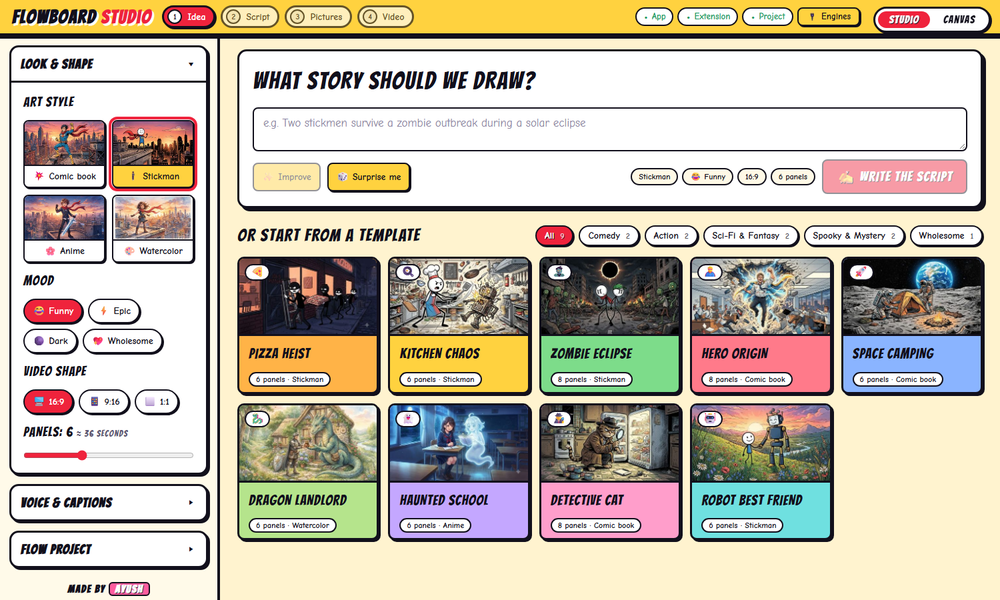
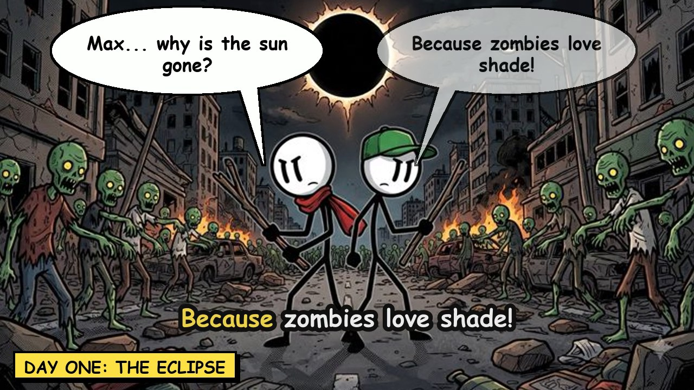
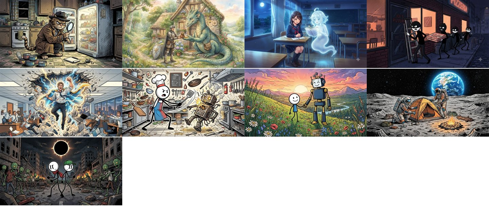
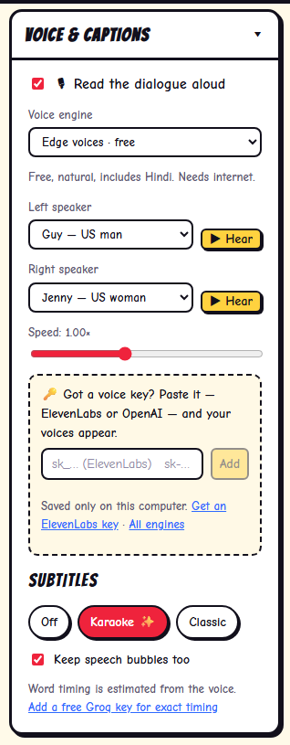
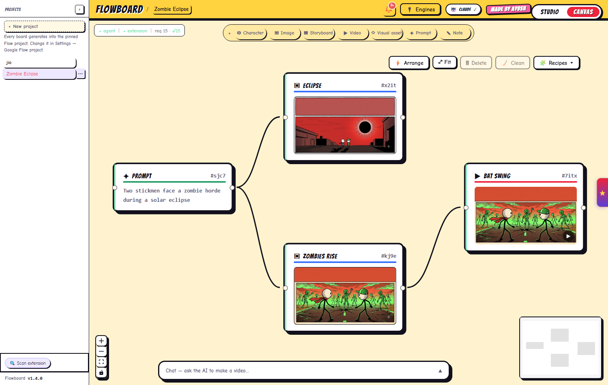
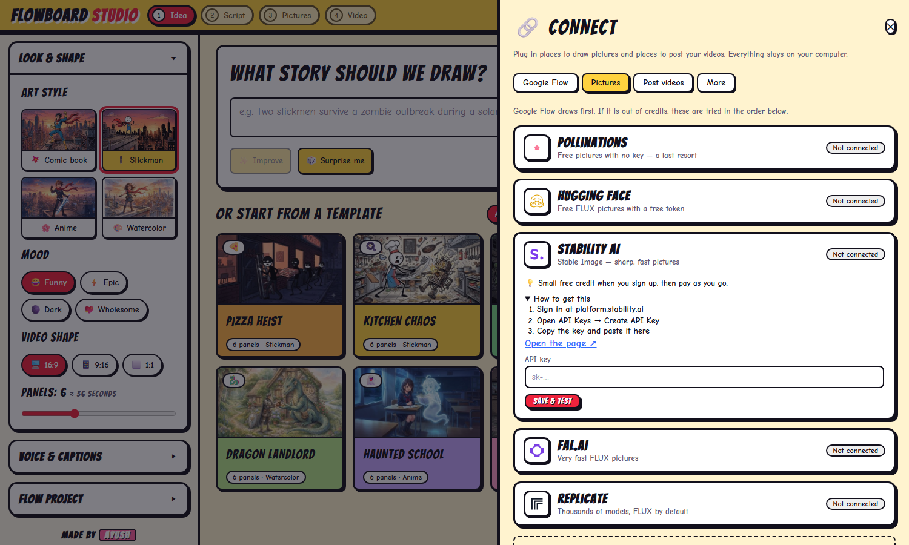
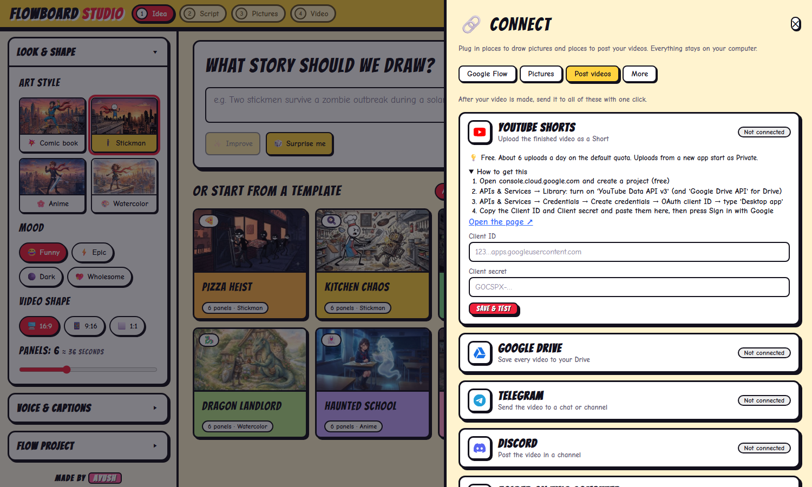
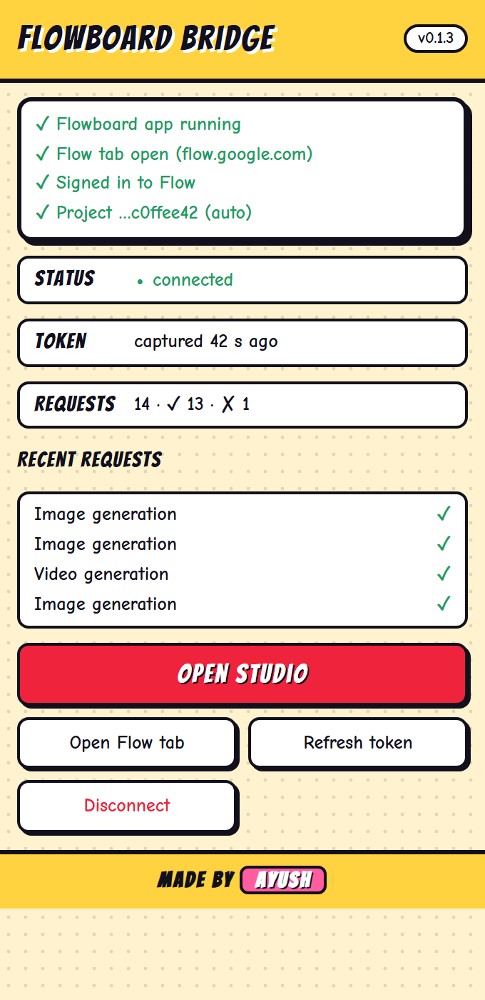

<h1 align="center">Flow Studio</h1>

<p align="center">
  <b>Type an idea. Get a comic video.</b><br/>
  A comic-style studio that writes the story, draws every panel, adds speech bubbles, voices and karaoke subtitles, and exports an MP4 — powered by your own Google Flow account and your own AI keys.
</p>

<p align="center"><i>Made by <b>Ayush</b></i></p>

<p align="center">
  
</p>

---

## What you get

| | |
|---|---|
|  |  |
| **16:9** comic frame with speech bubbles and a karaoke caption | **9:16** vertical frame for Reels, Shorts and TikTok |

Everything above is produced by the app itself: the pictures come from Google Flow, and the bubbles, captions, voices and video are put together by Flow Studio.



*Every template and art style in Studio shows a real sample picture, so you can tell stickman, comic, anime and watercolor apart at a glance.*

## Features

### 🎬 Studio — idea to video in four steps
- **One-screen studio layout, with no page scrolling:** settings on the left (art style, mood, shape, voice, subtitles), your work in the middle, properties on the right, and one bottom bar for drawing and exporting. On a small screen it becomes a normal scrolling page with the prompt first.
- **Type or pick:** a prompt box at the top of the home screen, with ✨ Improve and 🎲 Surprise me, and compact template cards below it. **＋ New story** takes you back from the editor.
- **Templates by category** (Comedy, Action, Sci-Fi & Fantasy, Spooky & Mystery, Wholesome) with real cover pictures, for instant starts.
- **Full-frame pictures:** no blank boxes. The script only asks for calm space at the top of a panel when its dialogue is long, and you can switch that per panel.
- **Picture backup:** if Google Flow's daily limit is reached, the other Flow models are tried, then your own OpenRouter or OpenAI key (uses your credits).
- **AI helpers:** write a whole script from one line, ✨ improve your idea, 🎲 get surprise ideas, and ✨ punch up any scene or line of dialogue.
- **Visual editor:** a filmstrip, a live preview, and speech bubbles you drag, resize and aim. Undo/redo with <kbd>Ctrl</kbd>+<kbd>Z</kbd> / <kbd>Ctrl</kbd>+<kbd>Y</kbd>.
- **Video shapes:** 16:9, 9:16 and 1:1.
- **Voiceover:** free Edge voices (including Hindi) and Windows voices out of the box. Paste an ElevenLabs or OpenAI key and its voices appear automatically.
- **Karaoke subtitles:** the word being spoken lights up. Timing is estimated for free, or exact with a Groq/OpenAI Whisper key.
- **MP4 export** with bubbles, captions, sound effects, slow zoom and fades. The finished video opens in a popup with a download button.



### 🧩 Canvas — a node board for power users
Character, Image, Video, Prompt, Storyboard and Note nodes you connect into a pipeline.
- Delete, duplicate, fold and colour-label nodes, with **Undo** after deleting.
- **Arrange**, **Fit**, **Clean** (remove empty nodes) and one-click **Recipes** (Hero shot, Prompt to picture, Storyboard film, Duo scene).
- Right-click menu, and new nodes never land on top of each other.
- A chat dock where you describe what you want and an AI agent builds the board for you. It sees what every node holds, uses the nodes you have **selected** (or whose `#id` you click), reuses your pictures instead of guessing, and stops after one result per request so it can never loop and burn credits.



### 🔗 Connect — more services, and posting your videos
One drawer with real logos and a green light for each service. Open it with **🔗 Connect**.



- **Google Flow in the background.** A separate Chrome or Edge window, kept out of sight, holds your signed-in Flow tab so Studio keeps drawing while you use your own browser. One-time setup (sign in and load the extension in that window), then **Start in background**. It can start by itself and reopens if it closes. A fully hidden browser fails Google's captcha, so the window is real but off screen.
- **More picture services** when Flow's daily limit is reached, tried in the order you choose: Pollinations (free, no key, often busy), Hugging Face (free token), Stability AI, fal.ai and Replicate.
- **Add any picture service** that has a web API: give the address, key header, request body and where the picture is in the reply.
- **Post your video** from the finished-video popup in one click: **YouTube Shorts**, **Telegram**, **Discord**, **Google Drive** or a **folder**. ✨ writes the title and hashtags for you. YouTube uploads start as *Private* until you choose otherwise.



All keys and sign-ins stay on your computer, and only masked hints are shown.

### 🤖 Use it from Claude Code
The `claude-skill/` folder is a ready-made **Claude Code skill**. Copy `claude-skill/flow-studio` into `~/.claude/skills/` and ask Claude in plain words ("make a 6-panel stickman video about …, then post it to Telegram"). Claude runs a small helper script against your local app. See [claude-skill/README.md](claude-skill/README.md).

### 🔌 Engines — bring your own AI keys
Paste any key and the app recognises it, tests it, and shows what it can do.

| Service | Key starts with | Used for |
|---|---|---|
| Groq | `gsk_` | fast writing, exact subtitle timing |
| Google Gemini | `AIza` | writing, picture description |
| NVIDIA | `nvapi-` | writing |
| OpenRouter | `sk-or-` | writing (some free models) |
| OpenAI | `sk-` | writing, voices |
| ElevenLabs | `sk_` | the most realistic voices |

- Every job (script, rewrite, ideas, canvas auto-prompt, planner, chat, subtitles, voice…) stays on **Auto** unless you choose otherwise.
- **Advanced:** pick the exact **model** per job and a **backup engine**. If one engine fails or runs out, the next one takes over.
- Shows a plain-language status for each job, and whether a key looks like a free or paid plan.
- Keys are stored **only on your computer** and are never sent back to the browser.

### 🌐 Browser extension — "Flowboard Bridge"
Runs your generation requests inside your own signed-in Google Flow tab, so there is nothing to hand over.
- **Follows the Flow project you have open** — no copying links.
- Brings the Flow tab forward and retries when Google's captcha times out.
- A popup with a setup checklist, plain-language hints, recent requests and an **Open Studio** button.

<p align="center"></p>

## How it works

```
 Chrome / Edge                          your computer
┌──────────────────────────┐   WebSocket  ┌──────────────────────────────┐
│ Flowboard Bridge         │◄────────────►│ Agent (FastAPI, port 8434)   │
│ runs requests in your    │              │  • Studio: script, render    │
│ signed-in Flow tab       │              │  • Engines: keys, models     │
└──────────────────────────┘              │  • Voice, subtitles, ffmpeg  │
         ▲                                └──────────────▲───────────────┘
         │ images / videos                               │ HTTP
   Google Flow                              ┌────────────┴───────────────┐
                                            │ Web app (React, port 5173) │
                                            │  Studio  ·  Canvas         │
                                            └────────────────────────────┘
```

## Requirements

- **Windows** (the one-click script is for Windows; macOS/Linux work with the manual steps)
- **Python 3.11+**, **Node 20+**, and **ffmpeg** on your `PATH`
- **Chrome or Edge**
- A **Google Flow** account with access to image generation (video models depend on your plan)
- Optional: any of the AI keys above

## Quick start

```powershell
git clone https://github.com/Ayushkumarpatel-AKP/flow-studio.git
cd flow-studio
powershell -ExecutionPolicy Bypass -File start.ps1
```

The script installs everything on first run, starts the agent (`:8434`) and the web app (`:5173`), and opens Studio.

**Then, once:**
1. Open `chrome://extensions` (or `edge://extensions`), turn on **Developer mode**, click **Load unpacked** and choose the `extension` folder.
2. Open [flow.google.com](https://flow.google.com), sign in, and open a project. Keep that tab open — the extension links it for you.
3. In Studio, pick a template or type an idea.

<details>
<summary>Manual start (any OS)</summary>

```bash
# agent
cd agent
uv venv --python 3.11
uv pip install --python .venv/bin/python -e .      # Windows: .venv\Scripts\python.exe
.venv/bin/python -m uvicorn flowboard.main:app --port 8434

# web app (second terminal)
cd frontend
npm install
npm run dev
```
Then open http://localhost:5173/?studio=1
</details>

## Adding AI keys

1. In Studio, open **🔌 Engines** (or the **Voice & captions** box for a voice key).
2. Paste a key. The app detects the service, tests it, and switches things on by itself.
3. Free tiers are enough to start: a free Groq key gives fast writing and exact subtitle timing.

Keys live in `~/.flowboard/engines.json` on your machine (override with the `FLOWBOARD_ENGINES` environment variable).

## Project layout

```
claude-skill/ Claude Code skill: lets Claude make and post videos by command
agent/      FastAPI service — Studio, Engines, voice, subtitles, renderer, Flow bridge
frontend/   React + TypeScript web app — Studio and Canvas
extension/  Browser extension (Manifest V3) — "Flowboard Bridge"
docs/       Screenshots and notes
start.ps1   One-click start for Windows
```

## Development

```bash
# agent tests (new engine / voice / subtitle suites)
cd agent
.venv/bin/python -m pytest tests/test_engines.py tests/test_studio_voice.py -q

# web app
cd frontend
npx tsc -b --noEmit && npm run build
```

## Good to know

- **Unofficial Flow connection.** Flow Studio talks to Google Flow through your own signed-in browser tab, using pages Google has not published as an API. It can stop working if Google changes them, and you should check Google's terms before relying on it.
- **Free tiers have limits.** Groq, Gemini, NVIDIA, OpenRouter and ElevenLabs all limit free usage. The app shows what it can read from each service and falls back to free voices if credits run out.
- **Local-first.** Projects, keys and generated files stay on your computer.
- **Posting uses official APIs only.** YouTube and Google Drive need a free Google Cloud client you create once; uploads from a new app stay private until Google reviews it.
- **Not affiliated** with Google, Groq, NVIDIA, OpenAI, OpenRouter or ElevenLabs. Product names belong to their owners.

## Roadmap

- A fully in-browser version of the extension (no local app) for the Edge Add-ons store.
- Background music that follows the mood of the story.
- "Magic create": one button from idea to finished video, with characters that stay consistent.
- Instagram, Facebook and TikTok posting (needs their app approval), and more video and music services.
- Site bridges: use other websites the way Flow is used today, through your own signed-in tab.

## License and credits

Released under the [MIT License](LICENSE). Flow Studio is built on top of the open-source **Flowboard** project (also MIT) by its original authors — their copyright notice stays with the code.

<p align="center"><b>Made by Ayush</b></p>
